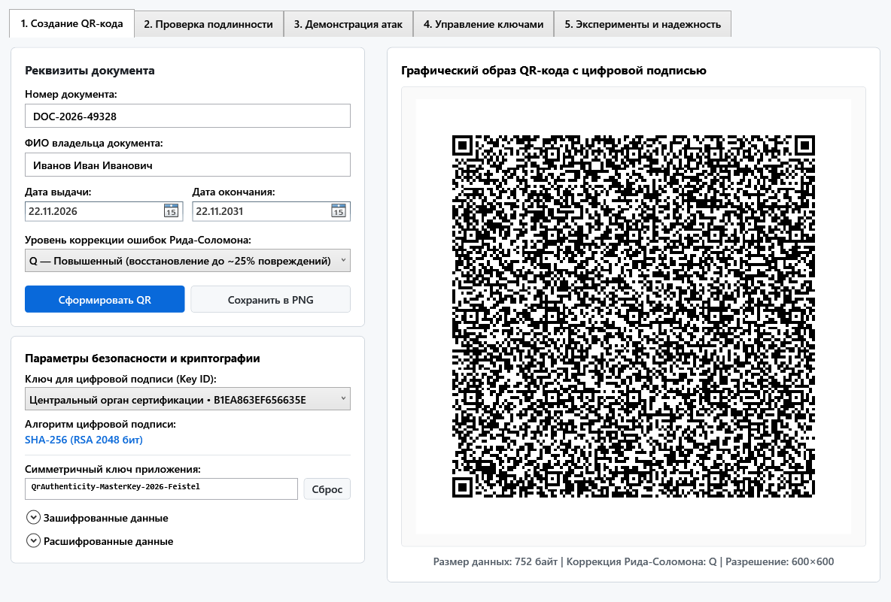
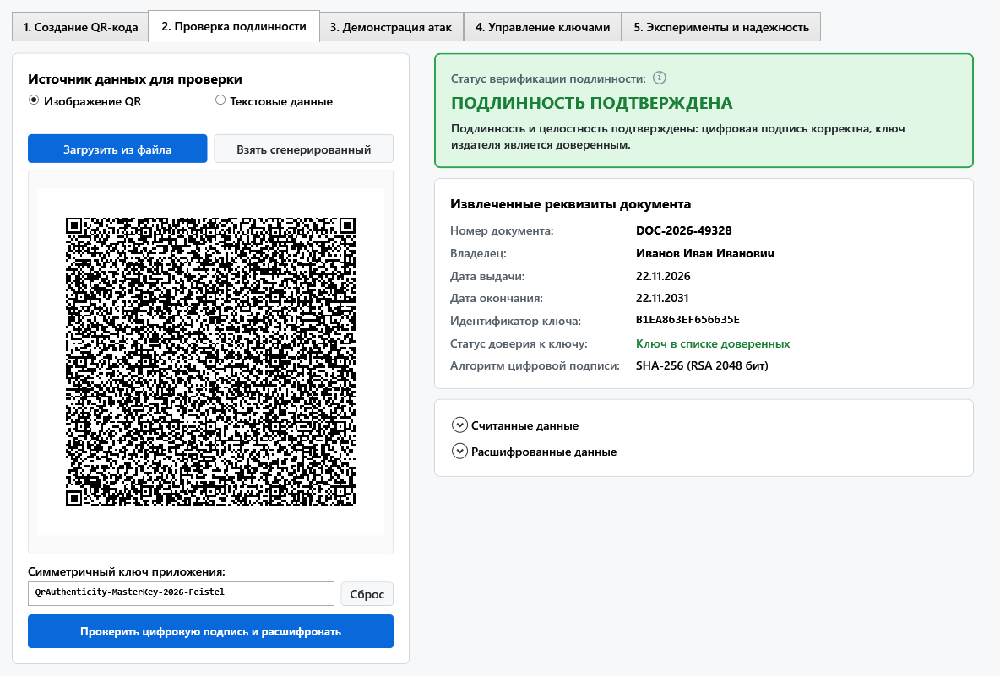
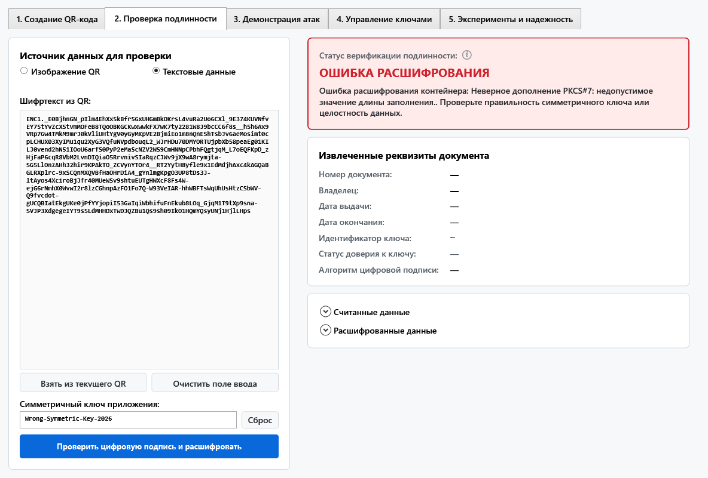
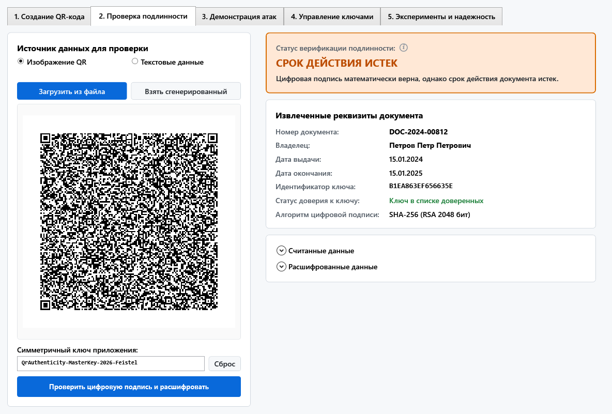
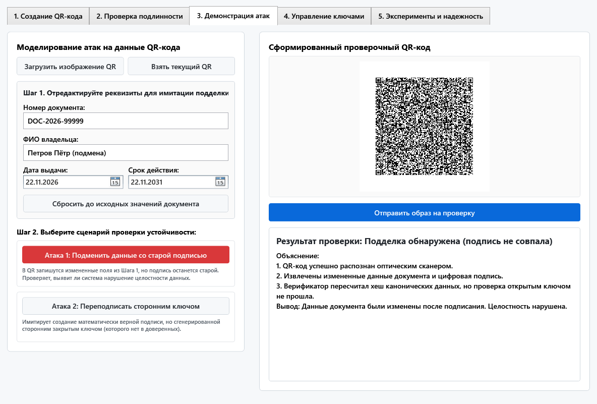
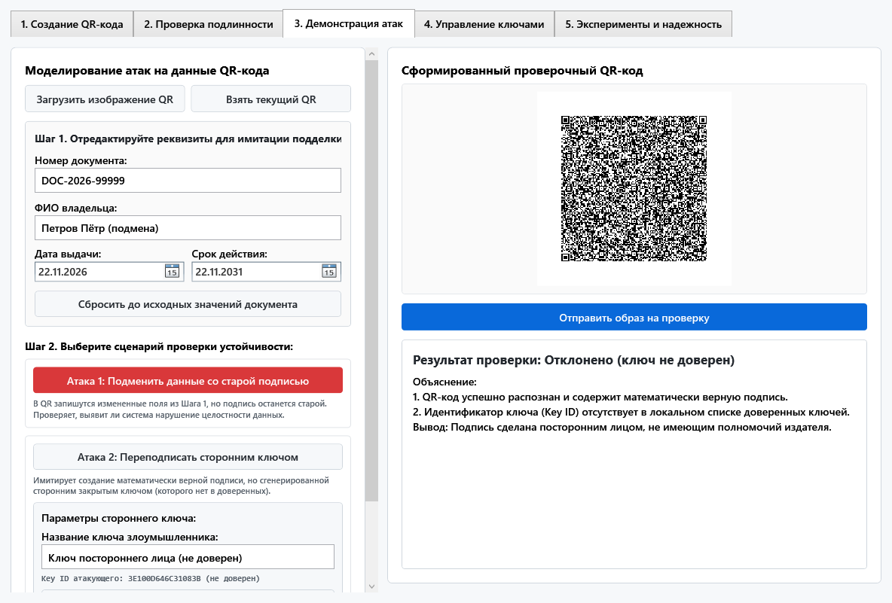
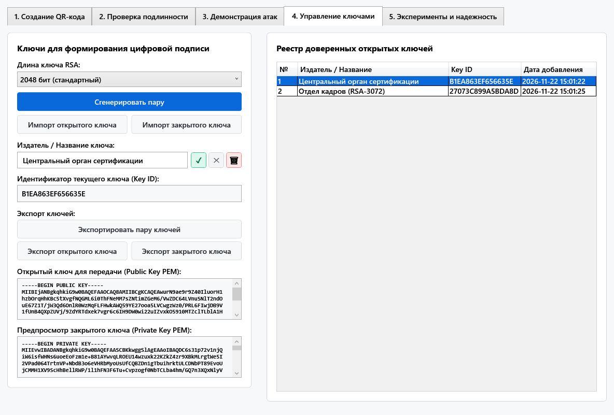
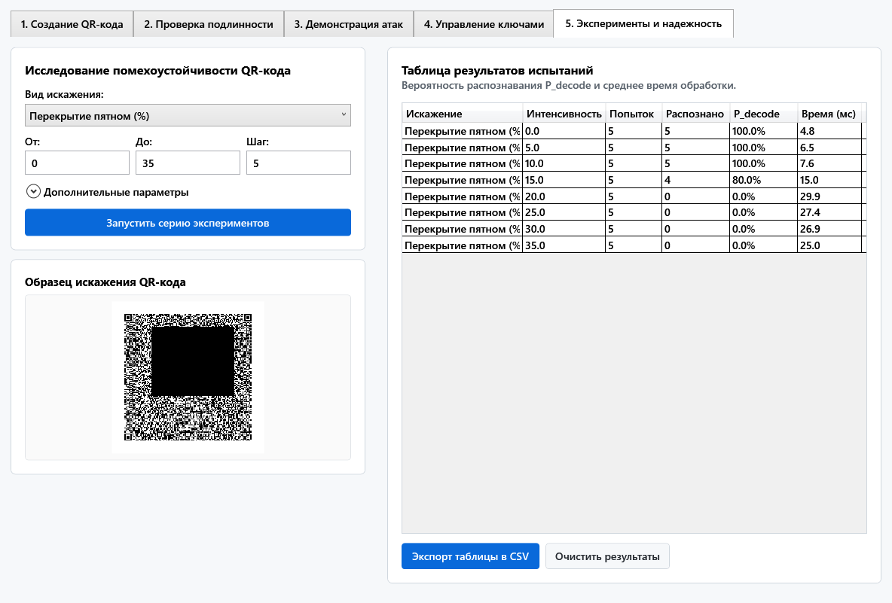

# Программное средство подтверждения подлинности данных в QR-кодах с использованием цифровой подписи

## 1. Назначение и актуальность проекта

Обычный QR-код является исключительно графическим контейнером для переноса данных. Он не содержит встроенных механизмов защиты, поэтому любой злоумышленник может сгенерировать поддельный QR-код, подменить текстовые реквизиты документа или перенаправить пользователя на фишинговый ресурс.

Целью данного программного средства является обеспечение целостности и подлинности авторства структурированных данных, передаваемых посредством QR-кодов, на основе асимметричной криптографии (электронной цифровой подписи).

## 2. Разработанный метод

1. **Канонизация данных (`PayloadCanonicalizer`)**:  
   Перед подписанием реквизиты документа приводятся к детерминированному байтовому представлению в кодировке UTF-8:
   - фиксированный порядок следования полей (`v`, `alg`, `kid`, `data`);
   - нормализация строк (обрезка краевых пробелов);
   - стандартное представление дат (`yyyy-MM-dd`);
   - отсутствие лишних пробельных символов и отступов.
2. **Формирование цифровой подписи (`SignatureService`)**:  
   Над каноническим байтовым массивом вычисляется цифровая подпись по современному криптографическому стандарту RSA-PSS с использованием хеш-функции SHA-256 (длина ключа 2048 или 3072 бит).
3. **Компактное кодирование (`Base64Url`)**:  
   Двоичная подпись кодируется в безопасный для URL и QR-сканеров формат Base64URL (без символов `+`, `/` и без хвостового выравнивания `=`).
4. **Формат контейнера (`SignedPayload`)**:
   ```json
   {
   	"v": 1,
   	"alg": "RSA-PSS-SHA256",
   	"kid": "81AF728C910B45C2",
   	"data": {
   		"document": "DOC-2026-49328",
   		"owner": "Иванов Иван Иванович",
   		"issued": "2026-09-18",
   		"expires": "2031-09-18"
   	},
   	"signature": "O_8xN-3V..."
   }
   ```
5. **Модель доверия (`TrustedKeyStore`)**:  
   Проверяющая сторона никогда не доверяет открытому ключу, извлеченному из самого QR-кода. Проверка подписи осуществляется исключительно по ключам, предварительно добавленным в локальное доверенное хранилище (`TrustedKeyStore`), сопоставляемым по отпечатку `kid`.

---

## 3. Структура проекта

В корне репозитория находится решение, а каждый проект размещен в отдельном каталоге:

```text
QrAuthenticity.sln
QrAuthenticity/
    QrAuthenticity.csproj
    App.xaml
    MainWindow.xaml
    Cryptography/
    Models/
    QR/
    Serialization/
    Services/
    Tabs/
    Verification/
    Experiments/
    docs/
QrAuthenticity.Tests/
    QrAuthenticity.Tests.csproj
    ...
QrAuthenticity.Cutted/
    QrAuthenticity.Cutted.csproj
    ...
QrAuthenticity.Cutted.Tests/
    QrAuthenticity.Cutted.Tests.csproj
    ...
```

Ниже перечислены классы полного приложения внутри каталога `QrAuthenticity/`.

- `Cryptography/`
  - `KeyManager.cs` — генерация пар RSA-2048/3072, экспорт/импорт в PEM, расчет Key ID.
  - `SignatureService.cs` — вычисление и проверка подписи RSA-PSS-SHA256.
  - `TrustedKeyStore.cs` — реестр доверенных открытых ключей издателей.
- `Models/`
  - `DocumentData.cs` — доменная модель реквизитов документа с валидацией.
  - `SignedPayload.cs` — транспортная модель подписанного контейнера.
  - `VerificationResult.cs` — статусная модель проверки подлинности.
  - `ExperimentResult.cs` — модель измерений устойчивости к помехам.
  - `TrustedKeyEntry.cs` — запись доверенного ключа с метаданными.
- `Serialization/`
  - `PayloadCanonicalizer.cs` — канонизатор байтов для цифровой подписи.
  - `PayloadCodec.cs` — сериализатор/десериализатор полного JSON.
  - `Base64Url.cs` — конвертер Base64Url.
- `Services/`
  - `PayloadCreationService.cs` — оркестратор создания и подписания контейнера.
- `Verification/`
  - `AuthenticityVerifier.cs` — проверка формата, доверия, подписи и срока действия.
- `QR/`
  - `QrCodeService.cs` — генерация матриц QR с уровнями Рида-Соломона (L, M, Q, H), декодирование растра.
- `Experiments/`
  - `ImageDistortionService.cs` — 7 моделей оптических и физических искажений (наклон, шум, перекрытие, размытие и т.д.).
  - `ExperimentRunner.cs` — выполнение серийных испытаний и расчет вероятности распознавания $P_{\text{decode}}$.
  - `StatisticsService.cs` — выгрузка результатов серий в CSV.
- `MainWindow.xaml` / `MainWindow.xaml.cs` — графический интерфейс (5 рабочих вкладок).

---

## 4. Графический интерфейс

1. **Создание QR-кода**: ввод реквизитов, выбор уровня коррекции Рида-Соломона (L, M, Q, H), подпись закрытым ключом, сохранение в PNG.
2. **Проверка подлинности**: загрузка изображения QR-кода, мгновенная верификация с цветовой индикацией статуса и извлечением реквизитов.
3. **Демонстрация атак**:
   - _Атака 1_: изменение полей документа со старой подписью (выявление нарушения целостности).
   - _Атака 2_: переподпись чужим закрытым ключом (выявление отсутствия доверия к источнику).
4. **Управление ключами**: создание пар RSA, экспорт закрытых и открытых ключей (PEM), ведение реестра доверенных ключей.
5. **Эксперименты и надежность**: моделирование физических дефектов QR-кода, запуск серий, таблица результатов и экспорт данных в CSV.

---

## 5. Требования для запуска

### Среда разработки и сборка

- ОС: Windows 10/11 (x64)
- Для конфигураций `Debug` / `Release` и сборки из исходников: .NET SDK 10+ (или .NET Desktop Runtime 10 для запуска готовой сборки).
- Для конфигураций `*-Standalone` и `*-SingleFile`: установка .NET Runtime на целевом компьютере **не требуется** (self-contained `win-x64`).
- Во всех конфигурациях решения оставлены только локали `ru` и `en` (`SatelliteResourceLanguages=ru;en`).

### Конфигурации решения и структура выходных файлов (`bin/`)

```text
bin/
    QrAuthenticity/                      (и аналогично QrAuthenticity.Cutted/)
        Debug/net10.0-windows/QrAuthenticity.exe
        Release/net10.0-windows/QrAuthenticity.exe
        Debug-Standalone/
            app/QrAuthenticity.exe       (+ runtime, зависимости и .pdb)
            Запустить программу.cmd
        Release-Standalone/
            app/QrAuthenticity.exe       (+ runtime и зависимости)
            Запустить программу.cmd
        Debug-SingleFile/
            QrAuthenticity.exe           (один самодостаточный файл, embedded .pdb)
        Release-SingleFile/
            QrAuthenticity.exe           (один самодостаточный файл)
    QrAuthenticity.Tests/
        Debug/net10.0-windows/QrAuthenticity.Tests.dll
        Release/net10.0-windows/QrAuthenticity.Tests.dll
    QrAuthenticity.Cutted.Tests/
        Debug/net10.0-windows/QrAuthenticity.Cutted.Tests.dll
        Release/net10.0-windows/QrAuthenticity.Cutted.Tests.dll
```

### Команды консоли

```powershell
# Сборка и запуск тестов в стандартных конфигурациях
dotnet test QrAuthenticity.sln -c Debug
dotnet test QrAuthenticity.sln -c Release

# Автономная сборка с папкой app/ и ярлыком-скриптом «Запустить программу.cmd»
dotnet build QrAuthenticity.sln -c Debug-Standalone
dotnet build QrAuthenticity.sln -c Release-Standalone

# Автономная сборка в один исполняемый файл (.exe)
dotnet build QrAuthenticity.sln -c Debug-SingleFile
dotnet build QrAuthenticity.sln -c Release-SingleFile
```

---

## 6. Руководство пользователя

### 6.1. Первый запуск и хранение ключей

- **Автономная папка (`Release-Standalone` / `Debug-Standalone`)**: откройте каталог сборки и запустите файл **`Запустить программу.cmd`**. Программа автоматически стартует с рабочим каталогом `app\`.
- **Один файл (`Release-SingleFile` / `Debug-SingleFile`)**: перенесите `QrAuthenticity.exe` в отдельную папку с правами на запись и запустите его.
- **Стандартная сборка (`Release` / `Debug`)**: запускайте `QrAuthenticity.exe` из `bin\QrAuthenticity\<Config>\net10.0-windows\` (на ПК должен быть установлен .NET Desktop Runtime 10).

При первом запуске программа автоматически генерирует стартовую ключевую пару **RSA-2048** («Центральный орган сертификации»), сохраняет её рядом с исполняемым файлом (внутри `app\` для `*-Standalone`) в каталогах:

- `trusted-keys\trusted_keys.json` — локальный реестр доверенных открытых ключей;
- `private-keys\<KeyID>.pem` — изолированные закрытые ключи для формирования подписи;

и сразу открывает первую вкладку с готовым демонстрационным QR-кодом.

---

### 6.2. Создание защищённого QR-кода (вкладка «1. Создание QR-кода»)

1. В блоке **«Реквизиты документа»** введите:
   - **Номер документа** и **ФИО владельца документа** (обязательные поля);
   - **Дату выдачи** и **Дату окончания** (если документ бессрочный, очистите поле «Дата окончания» — в контейнер запишется `null`). Дата окончания не может быть раньше даты выдачи.
2. Выберите **уровень коррекции ошибок Рида-Соломона**:
   - `L` (~7% повреждений) — минимальный размер матрицы;
   - `M` (~15% повреждений);
   - `Q` (~25% повреждений, по умолчанию) — оптимальный баланс плотности и устойчивости;
   - `H` (~30% повреждений) — максимальная защита от затираний и пятен.
3. В блоке **«Параметры безопасности и криптографии»** при необходимости:
   - выберите **ключ для цифровой подписи (`Key ID`)** из выпадающего списка (по умолчанию активен созданный ключ);
   - оставьте **симметричный ключ приложения** по умолчанию (`QrAuthenticity-MasterKey-2026-Feistel`) или введите собственный секрет для шифрования контейнера `ENC1.` алгоритмом Feistel-128-CBC (кнопка **«Сброс»** возвращает ключ по умолчанию).
4. Нажмите **«Сформировать QR»** — в правой части появится изображение QR-кода (`600×600 px`) и строка метрик (размер контейнера в байтах, уровень коррекции и разрешение).
5. Нажмите **«Сохранить в PNG»**, чтобы выгрузить QR-код в файл для печати или отправки. В нижней части левой панели можно развернуть спойлеры **«Зашифрованные данные»** (итоговая строка `ENC1....`) и **«Расшифрованные данные»** (подписанный JSON).



---

### 6.3. Проверка подлинности (вкладка «2. Проверка подлинности»)

Программа поддерживает два способа передачи данных на проверку:

- **Режим «Изображение QR»**: нажмите **«Загрузить из файла»** (PNG/JPG/BMP) или **«Взять сгенерированный»**, чтобы быстро проверить код с первой вкладки.
- **Режим «Текстовые данные»**: используйте его, если QR-код отсканирован камерой смартфона (сканер телефона покажет непроницаемую строку вида `ENC1....`). Вставьте считанную строку вручную или нажмите **«Взять из текущего QR»**.

Перед запуском убедитесь, что в поле **«Симметричный ключ приложения»** указан тот же ключ, который использовался при создании QR-кода, и нажмите **«Проверить цифровую подпись и расшифровать»**.

> **Важно:** если проверяется QR-код, выпущенный на другом компьютере, сначала импортируйте открытый `.pem`-ключ издателя на вкладке **«4. Управление ключами»**, иначе даже корректная подпись получит статус «Ключ издателя не доверен».



В правой панели отображаются цветовой статус верификации (подсказку по всем статусам можно также открыть по иконке **`i`**), извлечённые реквизиты, доверие к `Key ID`, алгоритм и спойлеры со считанными/расшифрованными данными. Ниже приведены примеры неуспешной или ограниченной проверки и полная расшифровка всех возможных вердиктов:





| Статус в интерфейсе                   | Цвет      | Что означает и что делать пользователю                                                                                                                                             |
| ------------------------------------- | --------- | ---------------------------------------------------------------------------------------------------------------------------------------------------------------------------------- |
| **ПОДЛИННОСТЬ ПОДТВЕРЖДЕНА**          | Зелёный   | Расшифровка прошла успешно, подпись RSA-PSS верна, `Key ID` присутствует в доверенном реестре, срок действия актуален. Сверьте извлечённые реквизиты с предъявленным документом.   |
| **СРОК ДЕЙСТВИЯ ИСТЕК**               | Оранжевый | Цифровая подпись математически верна и ключ доверен, но дата окончания действия уже прошла. Документ подлинный, однако просрочен.                                                  |
| **КЛЮЧ ИЗДАТЕЛЯ НЕ ДОВЕРЕН**          | Жёлтый    | Формат контейнера корректен, но идентификатор ключа `kid` не найден в `TrustedKeyStore`. Запросите открытый ключ у издателя по доверенному каналу и импортируйте его на вкладке 4. |
| **ПОДПИСЬ НЕВЕРНА (ДАННЫЕ ИЗМЕНЕНЫ)** | Красный   | Ключ найден, но проверка подписи RSA-PSS провалилась: после подписания были изменены реквизиты документа или подделана сама подпись. Доверять данным нельзя.                       |
| **ОШИБКА РАСШИФРОВАНИЯ**              | Красный   | Указан неверный симметричный ключ или повреждена строка `ENC1.`. Проверьте поле «Симметричный ключ приложения» (при необходимости нажмите **«Сброс»**) и повторите проверку.       |
| **НЕВЕРНЫЙ ФОРМАТ КОНТЕЙНЕРА**        | Красный   | Расшифрованные данные не являются корректным JSON-контейнером или нарушена кодировка Base64Url / валидация полей.                                                                  |
| **НЕСОВМЕСТИМЫЙ ПРОТОКОЛ**            | Жёлтый    | Версия протокола (`v != 1`) или идентификатор алгоритма (`alg != RSA-PSS-SHA256`) не поддерживаются этой версией программы.                                                        |
| **QR-КОД НЕ РАСПОЗНАН**               | Серый     | Декодер не смог прочитать матрицу с изображения из-за сильного размытия, перекрытия или шума. Загрузите более чёткое изображение.                                                  |

---

### 6.4. Демонстрация атак (вкладка «3. Демонстрация атак»)

Вкладка предназначена для наглядной проверки криптографической защиты от подделки QR-кода (в том числе при компрометации симметричного ключа шифрования):

1. Загрузите исходный подписанный документ кнопкой **«Взять текущий QR»** или **«Загрузить изображение QR»**.
2. В **Шаге 1** измените любые реквизиты (например, номер документа, ФИО или срок действия). Кнопка **«Сбросить до исходных значений документа»** возвращает исходные поля.
3. В **Шаге 2** выберите сценарий атаки, затем нажмите **«Отправить образ на проверку»** в правой панели:
   - **Атака 1: Подменить данные со старой подписью** — записывает в QR изменённые реквизиты со старой подписью. При проверке верификатор пересчитывает хеш канонических байтов, выявляет несоответствие подписи и выводит вердикт **«Результат проверки: Подделка обнаружена (подпись не совпала)»**.
   - **Атака 2: Переподписать сторонним ключом** — раскрывает панель генерации ключа злоумышленника, формирует новую математически корректную подпись RSA-PSS и перешифровывает контейнер. Верификатор отклоняет такой QR с вердиктом **«Результат проверки: Отклонено (ключ не доверен)»**, так как стороннего ключа нет в локальном доверенном реестре.





---

### 6.5. Управление ключами (вкладка «4. Управление ключами»)

В этой вкладке выполняется полный цикл управления асимметричными ключами издателя и доверенными ключами проверяющей стороны:

- **Генерация пары**: выберите длину модуля (**2048 бит** или **3072 бит**), при желании введите название издателя в поле **«Издатель / Название ключа»** и нажмите **«Сгенерировать пару»** — новая пара сразу сохраняется на диск и становится активной для подписи на вкладке 1.
- **Импорт ключей (PEM)**:
  - **«Импорт открытого ключа»** — добавляет только публичный `.pem`-файл стороннего издателя в **«Реестр доверенных открытых ключей»** (с таким ключом можно проверять его QR-коды, но нельзя подписывать новые).
  - **«Импорт закрытого ключа»** — загружает приватный PKCS#8 `.pem`-ключ (открытая часть вычисляется автоматически) и делает его активным ключом подписи.
- **Экспорт ключей (PEM)**: кнопки **«Экспортировать пару ключей»**, **«Экспорт открытого ключа»** и **«Экспорт закрытого ключа»** сохраняют выбранный в таблице (или текущий рабочий) ключ в формат `.pem`. Для передачи проверяющей стороне отправляйте **только открытый ключ** — закрытый ключ должен оставаться только у издателя.
- **Работа с таблицей доверенных ключей**:
  - **Одинарный клик** по строке таблицы показывает её `Key ID`, предпросмотр открытого и закрытого PEM, а также кнопки редактирования рядом с полем названия: **`✓`** (переименовать), **`✕`** (отменить редактирование и снять выделение), **`🗑`** (удалить ключ из реестра и с диска).
  - **Двойной клик** по строке (если для этого ключа на устройстве есть закрытая часть) сразу переключает его в качестве активного ключа подписи.



---

### 6.6. Эксперименты и надёжность (вкладка «5. Эксперименты и надежность»)

Вкладка служит экспериментальным стендом для оценки помехоустойчивости QR-кода (в том числе при разных уровнях коррекции Рида-Соломона `L`/`M`/`Q`/`H`, выбранных на вкладке 1):

1. Выберите **«Вид искажения»** — программа автоматически подставит рекомендуемый диапазон **От / До / Шаг**:
   - `Поворот (градусы)`
   - `Снижение разрешения (%)`
   - `Перекрытие пятном (%)`
   - `Импульсный шум (%)`
   - `Размытие (радиус)`
   - `Снижение контраста (%)`
   - `Сжатие JPEG (артефакты)`
2. При необходимости раскройте **«Дополнительные параметры»** и задайте количество **«Повторов на точку»** (по умолчанию `10`) и **«Seed (воспроизводимость)»** (по умолчанию `42`).
3. Нажмите **«Запустить серию экспериментов»**. В реальном времени обновляются индикатор прогресса, образец искажённого QR-кода внизу слева и таблица результатов справа (количество распознаваний, вероятность `P_decode` и среднее время декодирования в миллисекундах).
4. Нажмите **«Экспорт таблицы в CSV»**, чтобы сохранить результаты испытаний в UTF-8 CSV для построения графиков или отчёта (кнопка **«Очистить результаты»** сбрасывает таблицу).



---
